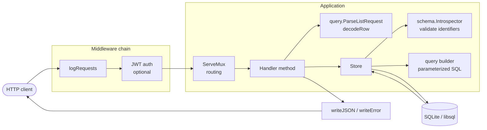
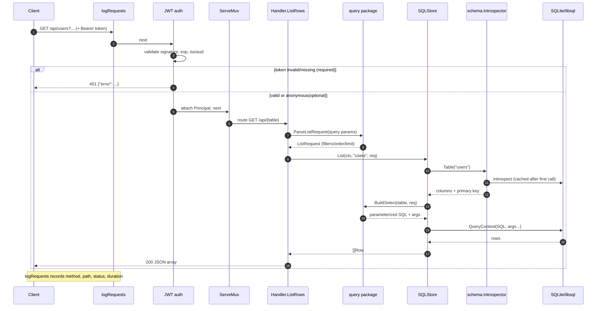
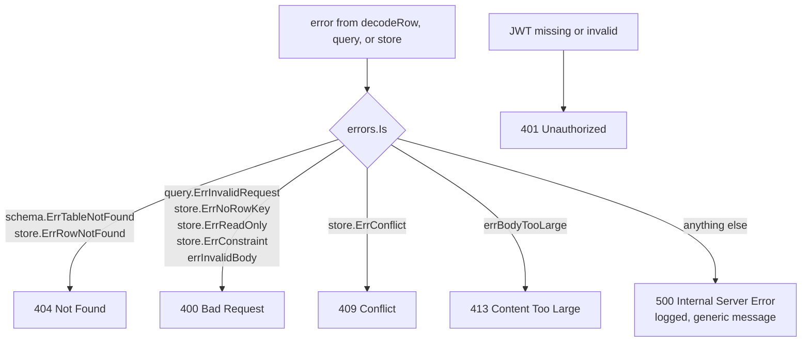

# Request flow

This page follows an HTTP request through libsql-rest, from the socket to the database and back. Every request passes through the same middleware and layers. The endpoint decides only which handler and which `Store` method run.

GitHub renders the Mermaid diagrams below. For other viewers, there are PNG copies of the [layers diagram](images/request-flow-layers.png) and the [sequence diagram](images/request-flow-sequence.png).

## Layers

`logRequests` wraps everything else, so the log records a request even when the auth middleware rejects it with a `401`.

The JWT middleware runs only when `auth.enabled` is true. It checks the bearer token and stores an `*auth.Principal` in the request context. With `auth.optional` set, a request without a token gets an anonymous principal. Row-level security will read the principal from there.

The handlers call the `Store` interface. `SQLStore` implements it. It looks up each table and column in the cached schema before it builds SQL, and it binds every value as a `?` parameter.

## Lifecycle of a filtered list request

This example follows `GET /api/users?age=gte.18&order=age.desc&limit=20` with an `Authorization: Bearer <jwt>` header.

## Endpoint reference

| Method and path | Handler | Store method | Success | Request body | Response body |
| --- | --- | --- | --- | --- | --- |
| `GET /openapi.json` | `OpenAPI` | `Tables` | `200` | None | OpenAPI 3.0 document |
| `GET /api/tables` | `ListTables` | `Tables` | `200` | None | `[{name, type}]` |
| `GET /api/{table}` | `ListRows` | `List` | `200` | None | Array of rows |
| `GET /api/{table}/{pk}` | `GetRow` | `Get` | `200` | None | Row |
| `POST /api/{table}` | `CreateRow` | `Insert` | `201` | Row | Row with defaults filled in |
| `PATCH /api/{table}/{pk}` | `UpdateRow` | `Update` | `200` | Some columns of a row | Updated row |
| `DELETE /api/{table}/{pk}` | `DeleteRow` | `Delete` | `204` | None | None |

`{table}` is any exposed table or view. `schema.Table.RowKey` decides which column `{pk}` matches. It returns the primary key when the key is a single column. A view, a table without a primary key, and a table with a composite key have no row key, so their `{pk}` routes return `400`. The OpenAPI document uses the same rule to decide which tables get item paths.

## Error mapping

Every error a handler returns has the body `{"error": "message"}`. `writeError` in `internal/server/response.go` picks the status from a table of sentinel errors. `SQLStore` wraps SQLite constraint failures in `store.ErrConflict` or `store.ErrConstraint`, and matches on SQLite's message text because the libsql driver reports no error code.

The JWT middleware writes its own `401` before the request reaches a handler. `ServeMux` answers an unknown path or an unsupported method with a plain-text `404` or `405`.

A table outside `allow_tables` returns `404`, the same as a table that does not exist. A client cannot use the allow list to find out which tables exist.
